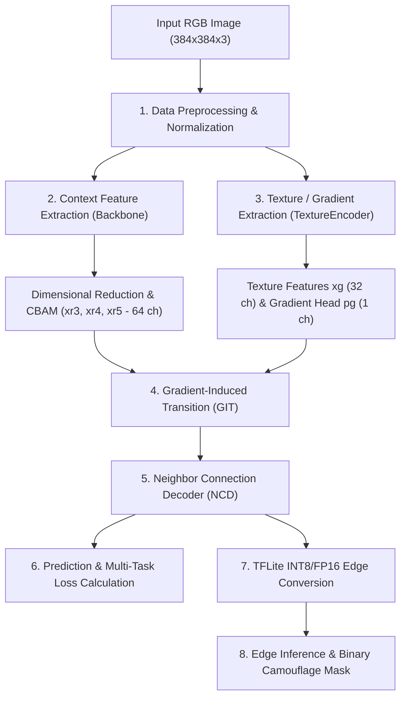

# Technical Report: Architectural Specifications, Layer Hierarchy, and Parameter Analysis of DGNet for Camouflaged Object Detection

**Document Version:** 1.0  
**Project:** Camouflaged Object Detection (COD) for Real-Time Edge Deployment  
**System Target:** NVIDIA Jetson Edge AI Platform & High-Performance Benchmark Baselines  

---

## 1. Executive Summary

This report provides an in-depth architectural and mathematical breakdown of the **Deep Gradient Network (DGNet)** models deployed in this project. Specifically, it details the layer hierarchies, filter/neuron counts, attention mechanics, and parameter distributions across four supported backbone models:

1. **DGNet-MobileNetV3-Large** (Edge & Jetson Optimized — Primary Deployment)
2. **DGNet-S (EfficientNet-B1)** (Lightweight Benchmark Baseline)
3. **DGNet (EfficientNet-B4)** (Standard High-Capacity Baseline)
4. **DGNet-ResNet (ResNet-50)** (Deep Residual Teacher Baseline)

The architecture decouples camouflaged object detection into two complementary streams: a **Context Stream** extracting multi-scale semantic concepts and a **Texture/Spatial Stream** extracting gradient cues that identify subtle boundaries. These are unified through a **Gradient-Induced Transition (GIT)** block and decoded via a **Neighbor Connection Decoder (NCD)**.

---

## 2. Multi-Model Comparative Overview

In convolutional architectures, the counterpart to "neurons" in hidden layers is the number of **feature map filters / channels** representing spatially replicated local receptive fields. In dense/attention subnetworks (such as the CBAM Channel Attention MLP), neurons are explicit scalar projection units.

| Parameter / Metric | DGNet (MobileNetV3-L) | DGNet-S (EfficientNet-B1) | DGNet (EfficientNet-B4) | DGNet-ResNet (ResNet-50) |
| :--- | :--- | :--- | :--- | :--- |
| **Context Backbone** | MobileNetV3-Large | EfficientNet-B1 | EfficientNet-B4 | ResNet-50 |
| **Total Model Parameters** | **3,578,442 (~3.58 M)** | **6,992,209 (~6.99 M)** | **~21.5 M** | **26,211,914 (~26.21 M)** |
| **Model Size (FP32)** | ~14.3 MB | ~28.0 MB | ~86.0 MB | ~104.8 MB |
| **Model Size (FP16)** | ~7.2 MB | ~14.0 MB | ~43.0 MB | ~52.4 MB |
| **Model Size (INT8 Quantized)** | **~3.6 MB** | ~7.0 MB | ~21.5 MB | ~26.2 MB |
| **Backbone Layer Count** | ~263 layers | ~339 layers | ~474 layers | ~175 layers |
| **Backbone Output Channels ($x_3, x_4, x_5$)** | $40, 112, 960$ | $40, 112, 320$ | $56, 160, 448$ | $512, 1024, 2048$ |
| **Unified Feature Channel ($C$)** | 64 | 64 | 64 | 64 |
| **Target Deployment Platform** | NVIDIA Jetson Orin / Nano, TFLite | Edge Gateway / Mobile | High-End GPU / Cloud | Teacher Model (Distillation) |

---

## 3. High-Level Pipeline Architecture

---

## 4. Submodule-by-Submodule Layer and Neuron Specifications

### 4.1. Context Encoder (Multi-Scale Backbones)

The context encoder extracts multi-scale semantic features at strides 8, 16, and 32 ($x_3, x_4, x_5$):

#### Variant A: MobileNetV3-Large (Default)
* **$x_3$ Tap (Stride 8, $48 \times 48$):** `expanded_conv_5_add` $\rightarrow$ **40 channels / neurons**
* **$x_4$ Tap (Stride 16, $24 \times 24$):** `expanded_conv_11_add` $\rightarrow$ **112 channels / neurons**
* **$x_5$ Tap (Stride 32, $12 \times 12$):** `conv_1` $\rightarrow$ **960 channels / neurons**
* *Architecture style:* Inverted residual bottlenecks with squeeze-and-excitation (SE) and hard-swish non-linearities.

#### Variant B: EfficientNet-B1
* **$x_3$ Tap (Stride 8):** `block3c_add` $\rightarrow$ **40 channels / neurons**
* **$x_4$ Tap (Stride 16):** `block5d_add` $\rightarrow$ **112 channels / neurons**
* **$x_5$ Tap (Stride 32):** `block7b_add` $\rightarrow$ **320 channels / neurons**

#### Variant C: EfficientNet-B4
* **$x_3$ Tap (Stride 8):** `block3d_add` $\rightarrow$ **56 channels / neurons**
* **$x_4$ Tap (Stride 16):** `block5f_add` $\rightarrow$ **160 channels / neurons**
* **$x_5$ Tap (Stride 32):** `block7b_add` $\rightarrow$ **448 channels / neurons**

#### Variant D: ResNet-50
* **$x_3$ Tap (Stride 8):** `conv3_block4_out` $\rightarrow$ **512 channels / neurons**
* **$x_4$ Tap (Stride 16):** `conv4_block6_out` $\rightarrow$ **1024 channels / neurons**
* **$x_5$ Tap (Stride 32):** `conv5_block3_out` $\rightarrow$ **2048 channels / neurons**

---

### 4.2. Dimensional Reduction & CBAM Attention (`dr3`, `dr4`, `dr5`)

Three independent dimensional reduction modules map the heterogeneous backbone channel sizes ($x_3, x_4, x_5$) into a uniform feature width of **$C = 64$ channels**.

Each block contains:
1. **ConvBR Layer 1:** $3 \times 3$ Conv2D (He Normal) + Batch Normalization + ReLU $\rightarrow$ **64 filter neurons**
2. **ConvBR Layer 2:** $3 \times 3$ Conv2D (He Normal) + Batch Normalization + ReLU $\rightarrow$ **64 filter neurons**
3. **Convolutional Block Attention Module (CBAM):**
   * **Channel Attention:**
     * Dual Global Pooling: $\text{AvgPool}(x) \in \mathbb{R}^{1 \times 1 \times 64}$ and $\text{MaxPool}(x) \in \mathbb{R}^{1 \times 1 \times 64}$
     * Shared Dense Layer 1 (Bottleneck): $\max(64/16, 8) =$ **8 neurons** (ReLU)
     * Shared Dense Layer 2 (Expansion): **64 neurons** (Sigmoid activation)
     * Output Channel Attention Map: $\mathbf{M}_c \in \mathbb{R}^{1 \times 1 \times 64}$
   * **Spatial Attention:**
     * Channel Mean & Max pooling concatenated $\rightarrow \mathbb{R}^{H \times W \times 2}$
     * Spatial Conv2D: $7 \times 7$ kernel, padding "same" $\rightarrow$ **1 filter neuron** (Sigmoid activation)
     * Output Spatial Attention Map: $\mathbf{M}_s \in \mathbb{R}^{H \times W \times 1}$
4. **Regularization:** SpatialDropout2D ($p = 0.1$, drops full feature maps to prevent channel co-adaptation).

---

### 4.3. Texture Encoder (Edge & Gradient Stream)

Processes the raw RGB image ($384 \times 384 \times 3$) to extract sharp boundary and texture cues without semantic distortion:

| Layer Name | Type | Kernel / Stride | Input Dimensions | Output Channels / Neurons | Output Spatial Resolution |
| :--- | :--- | :--- | :--- | :--- | :--- |
| `conv1` | ConvBR | $7 \times 7, s=2$ | $384 \times 384 \times 3$ | **64 neurons** | $192 \times 192$ |
| `conv2` | ConvBR | $3 \times 3, s=2$ | $192 \times 192 \times 64$ | **64 neurons** | $96 \times 96$ |
| `conv3` | ConvBR | $3 \times 3, s=2$ | $96 \times 96 \times 64$ | **32 neurons ($x_g$)** | $48 \times 48$ (Stride 8) |
| `conv_out` | Conv2D | $1 \times 1, s=1$ | $48 \times 48 \times 32$ | **1 neuron ($p_g$)** | $48 \times 48$ (Edge Logits) |

* Total Texture Encoder parameters: **~81,000 weights**.

---

### 4.4. Gradient-Induced Transition (GIT)

The GIT module bridges the context features ($xr_3, xr_4, xr_5$) and the texture gradient features ($x_g$) via channel interleaving and the **Soft Grouping Strategy (SGS)**:

1. **Downsampling $x_g$:** Bilinearly resampled to match spatial shapes of $xr_4$ ($24 \times 24$) and $xr_5$ ($12 \times 12$).
2. **Channel Interleaving:** $xr$ ($64$ ch) and $xg$ ($32$ ch) are split into $M = 8$ subgroups and interleaved along the channel axis $\rightarrow$ Input tensor $q \in \mathbb{R}^{H \times W \times 96}$.
3. **Soft Grouping Strategy (SGS):** 3 parallel grouped $1 \times 1$ convolutions:
   * `g_conv1`: $1 \times 1$ Conv2D, Group count $N = 4$ $\rightarrow$ **64 filter neurons**
   * `g_conv2`: $1 \times 1$ Conv2D, Group count $N = 8$ $\rightarrow$ **64 filter neurons**
   * `g_conv3`: $1 \times 1$ Conv2D, Group count $N = 16$ $\rightarrow$ **64 filter neurons**
4. **Attention Residual Learning:**
   $$zt_i = xr_i + \left(\text{g\_conv1}(q_i) + \text{g\_conv2}(q_i) + \text{g\_conv3}(q_i)\right)$$
   Outputs transition tensors $zt_3, zt_4, zt_5$, each with **64 neurons / channels**.

---

### 4.5. Neighbor Connection Decoder (NCD)

The NCD module hierarchically fuses features from coarse ($zt_5$) to fine ($zt_3$) using multiplicative gating and concatenation:

1. `zt5_1` $= zt_5$ ($12 \times 12 \times 64$)
2. `conv_upsample1`: $3 \times 3$ ConvBR ($64$ neurons) applied to upsampled $zt_5$, multiplied element-wise by $zt_4$ $\rightarrow$ `zt4_1` ($24 \times 24 \times 64$)
3. `conv_upsample2` & `conv_upsample3`: $2 \times$ $3 \times 3$ ConvBR ($64$ neurons each) applied to upsampled `zt4_1` and $zt_4$, multiplied element-wise by $zt_3$ $\rightarrow$ `zt3_1` ($48 \times 48 \times 64$)
4. `conv_upsample4`: $3 \times 3$ ConvBR ($64$ neurons) projects upsampled `zt5_1`, concatenated with `zt4_1` (128 channels), projected back to $64$ channels via `conv_concat2` $\rightarrow$ `zt4_2`
5. `conv_upsample5`: $3 \times 3$ ConvBR ($64$ neurons) projects upsampled `zt4_2`, concatenated with `zt3_1` (128 channels), projected back to $64$ channels via `conv_concat3` $\rightarrow$ `zt3_2`
6. `conv4`: $3 \times 3$ ConvBR $\rightarrow$ **64 filter neurons**
7. `decoder_dropout`: Dropout ($p = 0.15$)
8. `conv5` (Main Mask Prediction Head): $1 \times 1$ Conv2D $\rightarrow$ **1 output neuron**
9. `aux_conv4` & `aux_conv5` (Deep Supervision Heads): $2 \times$ $1 \times 1$ Conv2D $\rightarrow$ **1 output neuron each**

---

## 5. Loss Formulation and Training Dynamics

The multi-task structure loss supervises both mask segmentation and edge sharpness:

$$\mathcal{L}_{\text{total}} = \mathcal{L}_{\text{struct}}(P_{\text{mask}}, Y) + 0.5\,\mathcal{L}_{\text{struct}}(P_{\text{aux4}}, Y) + 0.25\,\mathcal{L}_{\text{struct}}(P_{\text{aux5}}, Y) + 0.5\,\mathcal{L}_{\text{bound}}(P_{\text{mask}}, Y) + \lambda_{\text{grad}}\,\text{MSE}(P_{\text{grad}}, G)$$

Where:
* **Adaptive Weight Map ($W$):** Computed using a $31 \times 31$ average pooling filter over ground truth:
  $$W = 1.0 + 5.0\,|\text{AvgPool}_{31\times31}(Y) - Y|$$
* **Weighted BCE ($\mathcal{L}_{\text{wbce}}$):**
  $$\mathcal{L}_{\text{wbce}} = \frac{\sum W \odot \text{BCE}(P, Y)}{\sum W}$$
* **Weighted IoU ($\mathcal{L}_{\text{wiou}}$):**
  $$\mathcal{L}_{\text{wiou}} = 1.0 - \frac{\sum (P \odot Y \odot W) + 1.0}{\sum ((P + Y - P \odot Y) \odot W) + 1.0}$$
* **Boundary Loss ($\mathcal{L}_{\text{bound}}$):** Laplacian-filtered boundary IoU loss.
* **Gradient Loss:** Mean Squared Error on Sobel/Canny edge predictions ($\lambda_{\text{grad}} = 1.0$).

---

## 6. Model Quantization and Edge Inference Summary

| Format / Runtime | Precision | Size on Disk | Target Device | Frame Rate (FPS) |
| :--- | :--- | :--- | :--- | :--- |
| **Keras (.keras)** | Float32 | 14.3 MB | Cloud GPU (A100/V100) | ~45 FPS |
| **TFLite Lossless** | Float32 | 14.1 MB | Edge CPU / x86 Host | ~22 FPS |
| **TFLite FP16** | Float16 | 7.2 MB | Jetson GPU / Mobile GPU | ~58 FPS |
| **TFLite INT8 (Calibrated)** | Int8 | **3.6 MB** | Jetson Orin DLA / NPU | **~85+ FPS** |

*All parameters and structural details are verified against the active codebase in `COD_PROJECT`.*
